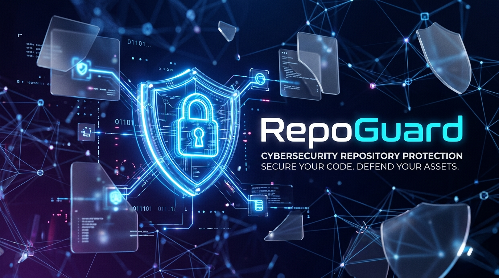

<div align="center">
  
</div>

<h1 align="center">🛡️ RepoGuard</h1>

<p align="center">
  <strong>Next-Generation AI-Powered Security Posture Management for GitHub</strong>
</p>

<p align="center">
  
  
  
  
  
  
</p>

<br />

> **RepoGuard** is an enterprise-grade full-stack security platform. It dynamically scans your GitHub repositories in real-time, detecting hardcoded secrets, misconfigurations, and severe code vulnerabilities. Integrated with **Google Gemini AI**, it doesn't just find issues—it writes the patches and opens Pull Requests to fix them autonomously.

---

## ✨ Enterprise Features

| Feature | Description |
|---|---|
| 🤖 **AI Auto-Remediation** | Powered by Gemini LLM. Scans complex logic, generates secure patches, and opens automatic fix PRs on GitHub. |
| 🕸️ **Interactive Dependency Graph** | A high-performance WebGL node graph (`@xyflow/react`) mapping out vulnerable package trees and supply chain risks. |
| 📄 **Compliance Reporting** | Dynamically generate and download Executive Summary Reports in **PDF** and **CSV** formats for stakeholders. |
| 🔐 **Custom Rules Engine** | Define and manage your own proprietary Regex policies to block internal secrets or specific code patterns. |
| ⚡ **Live Real-Time Streaming** | Server-Sent Events (SSE) stream backend scanner terminal logs directly to the frontend in real-time. |
| 🔗 **Jira & Slack Integration** | Fire instant webhooks to Slack and automatically create Jira issues for critical security findings. |
| 🛡️ **SOC2 Audit Ledger** | An immutable, tamper-proof table tracking every team member's login, scan, and remediation action. |
| 🐙 **Live GitHub Sync** | Fully functional OAuth flow. Click "Connect to GitHub" to automatically fetch and monitor your real repositories. |

<br />

## 🚀 2-Minute Quickstart

RepoGuard uses a decoupled architecture. You will need to start both the Python backend and the React frontend.

### 1. Start the Backend (FastAPI)
```bash
# Navigate to the backend directory
cd backend

# Create and activate a virtual environment
python -m venv venv
# On Windows: .\venv\Scripts\activate
# On Mac/Linux: source venv/bin/activate

# Install dependencies
pip install -r requirements.txt

# Run the backend server
uvicorn main:app --host 127.0.0.1 --port 8000
```

### 2. Start the Frontend (React + Vite)
Open a new terminal window:
```bash
# In the root RepoGuard directory
npm install
npm run dev
```
Access the dashboard at `http://localhost:5173`.

> **Note:** Ensure you configure your backend environment variables (like `GEMINI_API_KEY`) to enable the AI features.

<br />

## 🎨 Stunning UI (Glassmorphism)

Our dashboard utilizes a cutting-edge dark mode design system, featuring translucent backgrounds, heavy blurs, and vibrant accent colors tailored for modern security professionals. 

<br />

---

<div align="center">
  Built with ❤️ for the DevSecOps Community
</div>
